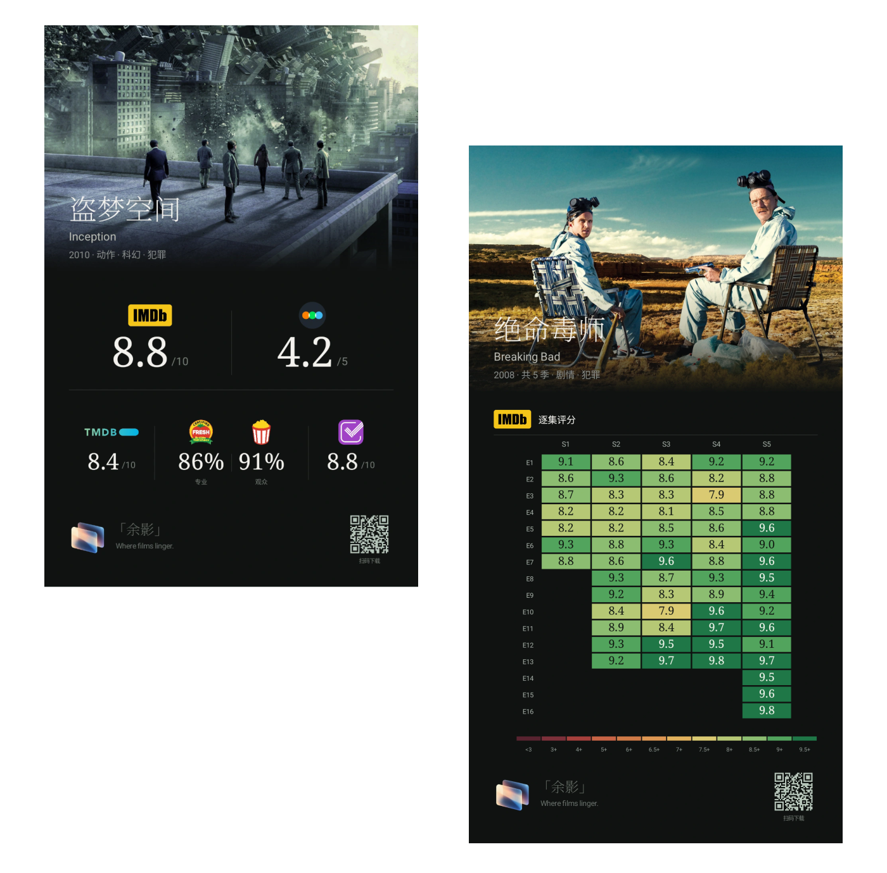
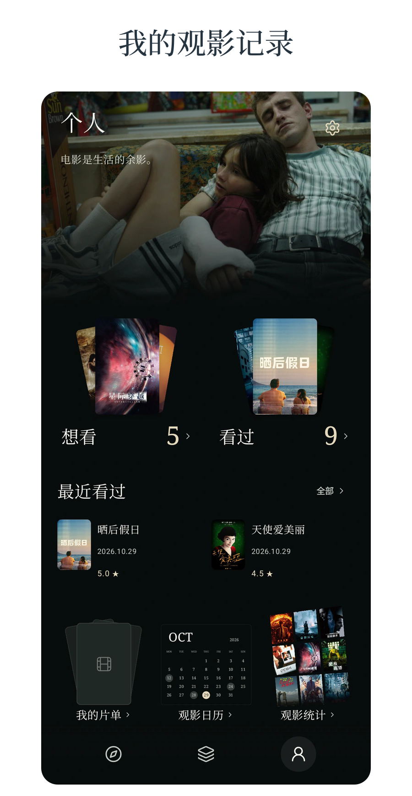
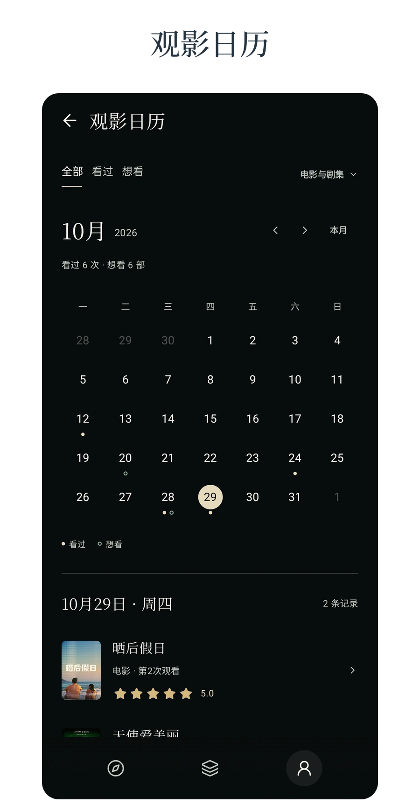
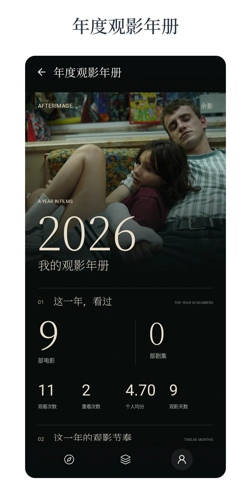
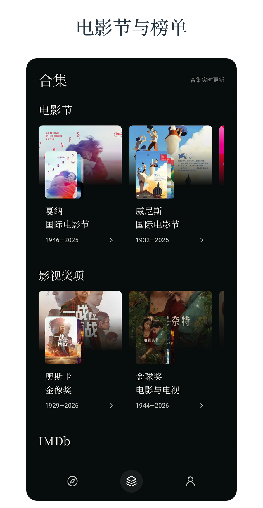
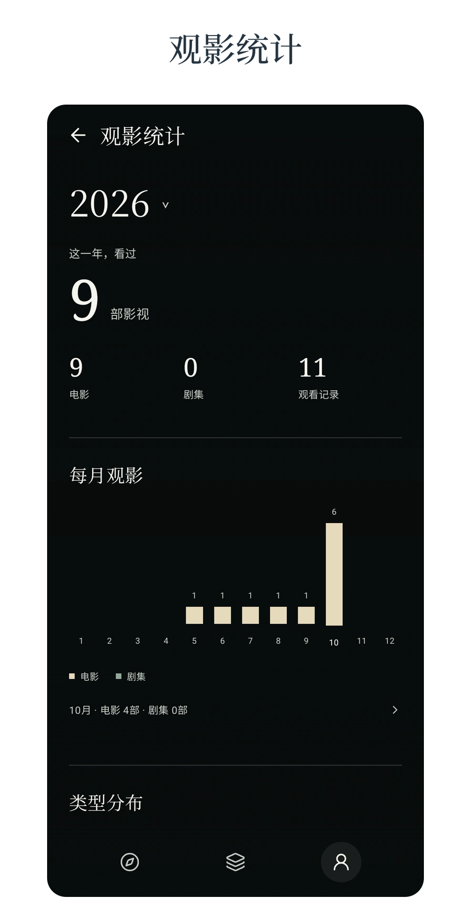

<strong>AFTERIMAGE（余影）</strong>是一款由电影爱好者独立开发的免费 Android 影视资料与观影记录应用。

<a href="https://api.yuyingfilm.top/app">下载 APK</a> · <a href="https://github.com/myy152/afterimage-releases/releases/latest">GitHub Releases</a>

## 评分海报

## 应用预览

  
  
  
  
  

## 功能

- **影视资料**：搜索电影、剧集与影人，查看简介、图片、演职员，浏览电影节及获奖合集。
- **多平台评分**：豆瓣、IMDb、烂番茄、Letterboxd、TMDB、Trakt；支持分季和 IMDb 逐集评分。
- **个人记录**：想看、看过、半星评分、日期、短评、重看和自定义片单。
- **观影回顾**：日历、统计、年度年册及分享海报，可保存图片或通过系统分享。
- **本地备份**：观影记录保存在手机，可导出和导入 JSON，无需注册余影账号。

## 安装与更新

下载 APK 后按系统提示安装。更新可在「个人 → 设置 → 版本更新」中完成，直接覆盖安装，**请勿先卸载**。换机或清理数据前，请在「设置 → 备份与恢复」中导出记录。

豆瓣评分怎么设置？

打开「个人 → 设置 → 豆瓣 Cookie」，通过豆瓣官网网页登录自动获取，或手动填写。Cookie 加密保存在本机，查询时经 HTTPS 传给网关，仅用于获取豆瓣评分和条目信息。不设置也可使用其他功能。

为什么有的作品缺分、图片或下载加载慢？

各平台的收录与评分范围不同，网络及第三方服务限制也可能影响加载，可稍后重试或切换网络。GitHub 下载慢时可使用上方「下载 APK」入口。评分及资料以原平台为准。

## 声明

余影由个人独立开发，永久免费、无广告、无内购，**仅供个人学习与研究，禁止用于商业用途**。不提供影视作品的播放、下载或资源链接服务。

第三方内容的权利归相应权利人。使用时请遵守各平台规则；本项目与各平台无官方隶属、合作或背书关系。[完整免责声明](DISCLAIMER.md)。

### 数据来源

TMDB、豆瓣、IMDb、烂番茄、Letterboxd、Trakt。

This product uses the TMDB API but is not endorsed or certified by TMDB.

反馈与权益问题：[13233752913@163.com](mailto:13233752913@163.com)
