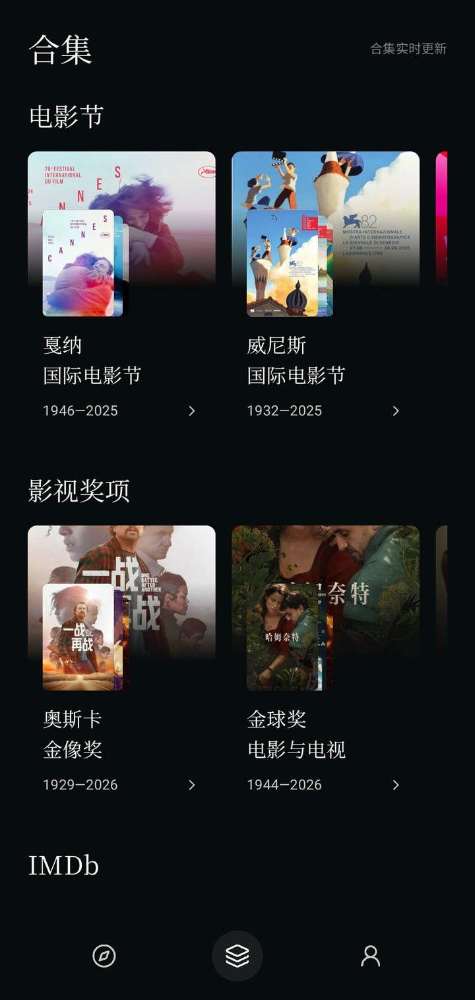
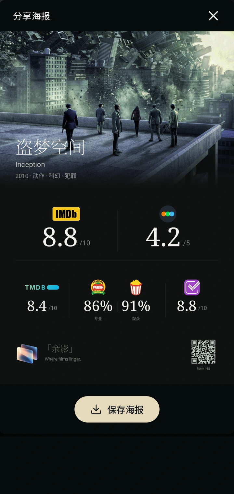
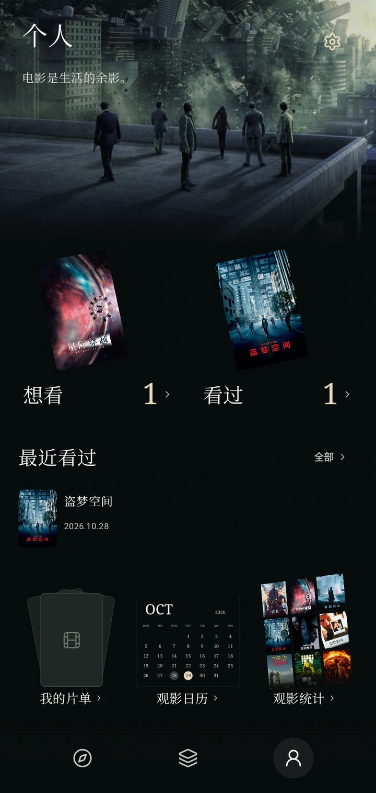
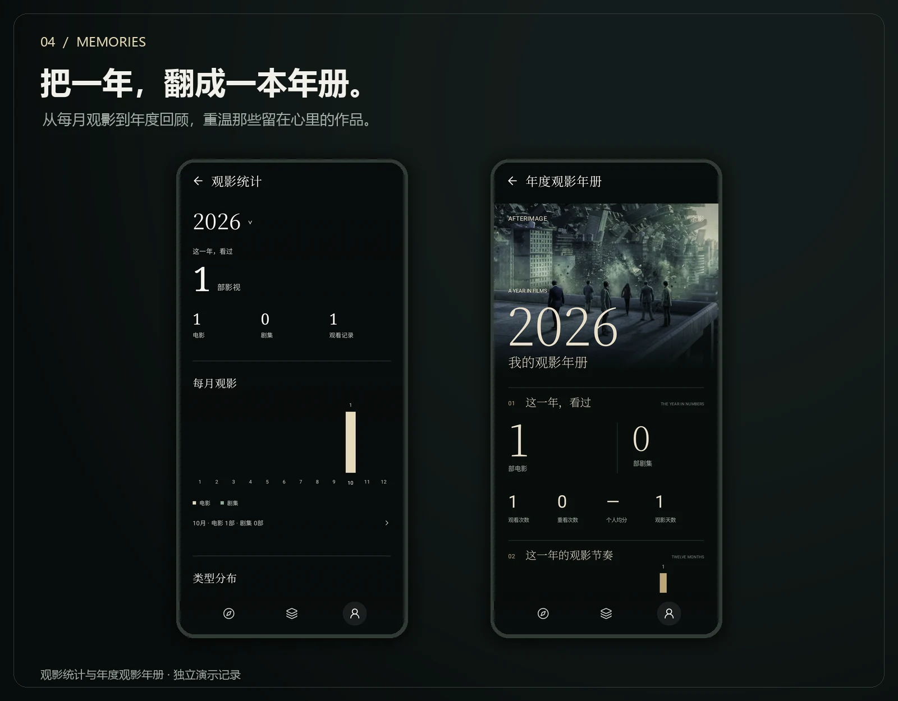

  

<h1 align="center">余影 · AFTERIMAGE</h1>

<strong>Where films linger.</strong> 发现值得看的作品，留下属于你的观影时光。

Android 8.0+ · 永久免费 · 无广告 · 无内购

  
  &nbsp;
  

<a href="#开始使用">开始使用</a> · <a href="#常见问题">常见问题</a> · <a href="#声明与使用约定">声明与使用约定</a>

---

余影是一款由个人独立开发的影视资料与观影记录应用。你可以在这里查看电影与剧集信息，参考不同平台的评分，把想看的作品放进口袋，也为看过的电影留下自己的分数、日期与感受。

**电影会结束，但有些东西会留下。**

## 发现下一部，值得记住的作品

从热门推荐开始，也可以直接搜索电影、剧集、演员或导演。作品详情汇集简介、图片、演职员和评分；从一部喜欢的电影，继续找到喜欢的人和他们的作品。

合集收录 IMDb 榜单、三大电影节及奥斯卡、金球、艾美等历届获奖目录，方便沿着不同线索探索。目录覆盖以应用内实际展示为准。

## 一个作品，多种参考

对照不同平台的评价，再形成自己的判断。余影支持豆瓣、IMDb、烂番茄、Letterboxd、TMDB、Trakt 六个平台，并为剧集提供整剧、分季及 IMDb 逐集评分视角。

- **电影与剧集详情**：资料、简介、演职员及可用来源评分集中查看。
- **分季与逐集**：按季查看，借助逐集评分了解一部剧的变化。
- **评分分享海报**：把作品信息与可用评分整理成图片，保存或通过系统分享。

不同平台的收录范围、评分口径与更新时间各不相同，并非所有作品、季度或单集都有评分；缺分和网络受限会按实际状态显示。

## 把看过的，都留住

不必让观影记录散落在不同地方。想看、看过、重看、分季进度和自定义片单，都可以在个人页找到。

| 你想做什么 | 余影可以帮你 |
|---|---|
| 留住下一部想看的片子 | 电影加入想看，电视剧整剧加入想看 |
| 记录自己的观影感受 | 五星半星评分、观看日期与短评 |
| 再看一次喜欢的作品 | 每次观看分别记录，保留重看历史 |
| 整理自己的主题片单 | 自定义片单名称、封面和作品顺序 |
| 回顾一个月或一年 | 观影日历、观影统计与年度观影年册 |
| 换机前保留记录 | JSON 备份、导入预览与合并恢复 |

## 一年过去，电影还在

在观影统计中回看每月的观影数量与类型分布，也可以打开年度观影年册，把这一年的作品和观影足迹整理成一份回忆。年册支持保存图片或通过系统分享。

截图来自正式 Android 应用；其中的个人评分、观看日期与记录为独立演示数据，不代表平台评分或真实用户的个人经历。展示图仅作排版，功能以当前安装版本为准。

## 开始使用

1. 打开[余影下载页](https://api.yuyingfilm.top/app)，下载 Android APK；也可从 [GitHub Releases](https://github.com/myy152/afterimage-releases/releases/latest) 下载 `afterimage.apk`。
2. 按 Android 系统提示完成安装。若系统要求授权，请只为你实际使用的下载工具开启安装权限。
3. 打开应用，搜索作品或浏览推荐。观影记录无需注册余影账号，保存在手机本地。
4. 如需使用豆瓣评分，可前往「个人 → 设置 → 豆瓣 Cookie」，选择网页登录自动获取，或保留手动填写方式。

**更新已有版本**：在「个人 → 设置 → 版本更新」中检查、下载并按系统提示安装。较早版本的入口名称是「关于与更新」。正式版本沿用同一签名，可覆盖升级；升级或换机前建议先导出备份。不要为了更新而卸载应用，卸载可能移除本地记录。

## 常见问题

<strong>余影能看电影或下载影视资源吗？</strong>

不能。余影提供影视资料、评分参考和个人观影记录，不提供任何影视作品的在线播放、下载或资源链接服务。

<strong>为什么豆瓣评分需要设置 Cookie？</strong>

豆瓣匿名访问可能受限。你可以在应用内打开豆瓣官网完成登录并自动获取 Cookie，也可以手动填写；是否配置由你决定，其余功能可以继续使用。Cookie 可能失效，失效后需要重新设置。

Cookie 凭据加密保存在本机，用于获取豆瓣评分及相关条目信息；查询时通过 HTTPS 发送给余影网关，再由网关向豆瓣发起相关请求。它不是豆瓣官方向余影提供的 OAuth 授权。请勿在反馈、截图或公开评论中发送 Cookie。

<strong>所有作品都能显示六个平台的评分吗？</strong>

不能保证。平台可能没有收录某个作品，也可能没有对应的分季、逐集评分，或因网络与外部服务调整暂时不可用。不同来源的评分不宜直接当作同一统计口径，具体内容应以原平台为准。

<strong>下载慢、图片不显示或部分评分加载失败怎么办？</strong>

GitHub 下载受网络环境影响，较慢时可改用[自有下载页](https://api.yuyingfilm.top/app)。图片和第三方评分服务也可能受当前网络影响，可稍后重试或换一个网络对照。不同地区和运营商的可用性可能不同，不承诺所有网络始终可用。

<strong>记录会自动同步到另一台手机吗？</strong>

目前没有云端账号同步。观影记录保存在本机，请在「设置 → 备份与恢复」中导出 JSON，并妥善保存；换机后可导入。请定期备份，避免清除数据或卸载造成丢失。

## 声明与使用约定

**余影仅供个人学习、研究及非商业交流使用，禁止用于商业用途。**

- 软件永久免费、无广告、无内购、无付费会员，不收取下载或使用费用，不出售影视数据。
- 不提供影视作品的在线播放或下载服务，不以此分发影视资源。
- 第三方名称、评分、海报、剧照及相关资料的权利归相应权利人；使用时应遵守各平台的适用规则。
- 本项目与第三方评分平台不存在官方隶属、合作或背书关系。资料仅供参考，以原平台为准。
- 本仓库仅用于发布说明、展示素材与 APK 分发，**应用源码未公开**。公开展示不构成对第三方内容的再授权。

请阅读[完整免责声明](DISCLAIMER.md)。应用内「设置 → 免责声明」也可查看。

## 数据来源

影视资料、图片与评分信息来自 TMDB、豆瓣、IMDb、烂番茄、Letterboxd 和 Trakt。

This product uses the TMDB API but is not endorsed or certified by TMDB.

## 反馈与支持

功能建议、使用反馈及权益问题请联系：[13233752913@163.com](mailto:13233752913@163.com)。反馈时可附上应用版本、手机型号、Android 版本、复现步骤及不含个人隐私的截图；请不要发送密码、Cookie 或备份中的私人记录。

余影是一个由电影爱好者在业余时间开发和维护的个人项目。如果你愿意支持它，可以在应用内「关于余影」中自愿赞助。赞助不附带付费权益，也不会影响任何功能的正常使用。

---

<strong>AFTERIMAGE · 余影</strong> <em>Where films linger.</em>

